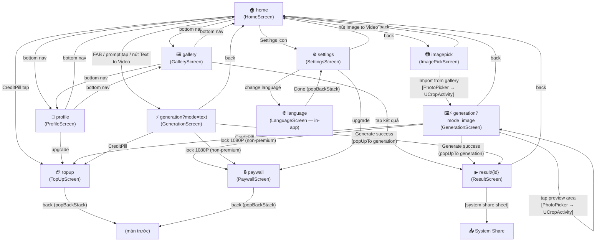

# Navigation Map — Columbia

_Cập nhật: 2026-07-15 · Phản ánh source code tại `generated/Columbia-20260714-151058`_

---

## Flow A — Onboarding (AnimatedContent state machine — `App.kt`)

Không dùng NavHost; là state machine một chiều, mỗi bước chỉ đi tiếp, không quay lại.

```
Splash ──► Language ──► Onboarding ──► MainScreen (NavHost)
```

---

## Flow B — MainScreen NavHost (`MainScreen.kt`, startDestination = `home`)



---

## Màn tiện ích — do lib/hệ thống cấp (NGOÀI NavHost)

Các màn này **không có Compose route**, được trigger bằng ActivityResult launcher.
Phải ghi rõ hợp đồng tương tác để không bị bỏ sót khi test và khi nâng cấp lib.

| Màn | Loại | Trigger | OK path | Cancel path |
|-----|------|---------|---------|-------------|
| **PhotoPicker** | Android system (`PickVisualMedia`) | `pickLauncher.launch(ImageOnly)` | Uri ảnh → mở UCropActivity | null → không làm gì |
| **UCropActivity** | Library `yalantis:ucrop:2.2.9` | `ucropLauncher.launch(intent)` | `RESULT_OK` + `UCrop.getOutput(data)` → Uri crop | `RESULT_CANCELED` → không làm gì |
| **System share sheet** | Android system (`ACTION_SEND`) | `shareVideo()` trong ResultScreen | Người dùng chọn app → chia sẻ | Dismiss → quay lại ResultScreen |
| **AdMob ConsentForm** | SDK (`AdsManager.runConsentFlow`) | Gọi từ `CheckForConsent()` khi vào Home | `onConsentComplete` callback | `onConsentError` callback |

> **Luật bảo trì:**
> - Khi nâng cấp `ucrop` version → phải verify lại: button ✓ (Done) và ✕ (Cancel) hiển thị đúng theme, Cancel path trả về đúng `RESULT_CANCELED`.
> - UCropActivity **phải được khai thủ công** trong `AndroidManifest.xml` vì jitpack aar 2.2.9 có AndroidManifest rỗng.

---

## Leaf paths cần exercise ở Phase 06

Checklist này dùng cho tester/AI khi chạy phase06:

- [ ] Splash → Language → Onboarding → Home (render đúng không trắng)
- [ ] Home → Generation (text mode) → nhập prompt → Generate → Result
- [ ] Home → Gallery → tap kết quả → Result
- [ ] Home → Profile → bottom nav qua lại Home/Gallery
- [ ] Home → Settings → thay đổi ngôn ngữ → back → Settings → back → Home
- [ ] Home → TopUp → back
- [ ] Generation (text) → lock 1080P → Paywall → back → Generation
- [ ] Home → Image to Video → ImagePick → Import → **PhotoPicker chọn ảnh** → **UCrop mở đúng theme** → ✓ xác nhận → Generation (image mode, ảnh hiện trong preview)
- [ ] Home → Image to Video → ImagePick → **Cancel PhotoPicker** → vẫn ở ImagePick (không crash)
- [ ] Home → Image to Video → ImagePick → Import → PhotoPicker → **✕ huỷ UCrop** → vẫn ở ImagePick (không crash)
- [ ] Generation (image) → tap preview → crop ảnh → ảnh cập nhật trong preview
- [ ] Generation (image) → Generate → Result → share → System share sheet → Dismiss → vẫn ở Result
- [ ] WelcomeBack overlay (nếu app pause > threshold) → dismiss → Home bình thường
